# 使用 Google Colab 訓練 YOLOv5 口罩偵測模型

[](https://colab.research.google.com/github/11325017-ship-it/yolov5-mask-detection-colab/blob/main/yolov5_mask_training.ipynb)

> 組員：11325017\_梁駿勝, 11325006\_黃靖傑

> 程式碼在 `yolov5_mask_training.ipynb`，說明與實驗結果在這份 `README.md`。本文的數據都來自 notebook 保留的實際執行輸出。

## 快速開始：Colab創建

1. 點擊 New（新增），並將滑鼠移到 More（更多），選擇 Google Colaboratory。

   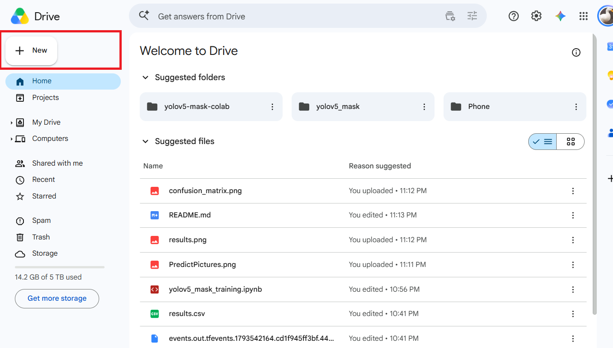

   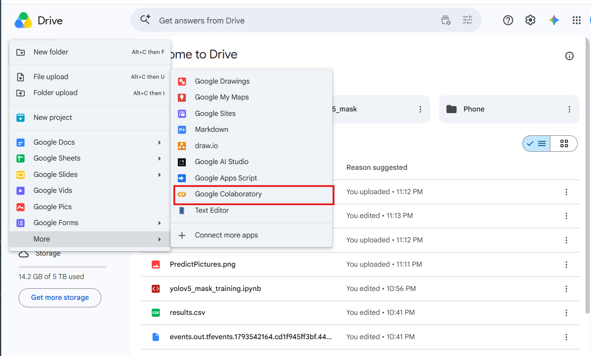

   > 如果選單中沒有 Google Colaboratory，請到 Google Workspace Marketplace 搜尋 Google Colaboratory 並安裝。

## 快速開始：資料集怎麼下載

### 資料集來源

本專案使用 Roboflow Universe 上的 **Face Mask Detection**（作者 `sparrowdhanashree`，version 1），以 YOLOv5 PyTorch 格式匯出：

- 資料集頁面：[https\://universe.roboflow.com/sparrowdhanashree/face-mask-detection-dvj6g/dataset/1](https://universe.roboflow.com/sparrowdhanashree/face-mask-detection-dvj6g/dataset/1)  
- 內容：共 2,157 張圖片，其中訓練集 1,824 張、驗證集 239 張、測試集 94 張。  
- 類別：`mask_weared_incorrect`、`with_mask`、`without_mask`。

> **授權**：資料集內的 `data.yaml` 標示授權為 **CC BY 4.0**（允許重新散布與使用，但必須標示原作者）。本專案把它放在 Releases 方便執行，原作者與來源已列在本文最後的[參考資料](#十參考資料)。

### 方式一：直接執行（預設）

不用做任何事。notebook 的 `DATASET_URL` 已經指向本 repo Releases 中的資料集。

### 方式二：換成自己的資料集

1. 登入 Roboflow（免費註冊），並點選YOLOv5如圖中的紅框。

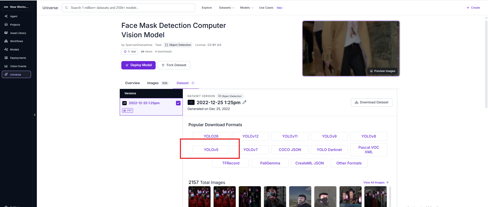

2. 點選頁面上的「Download Dataset」（下載資料集）。

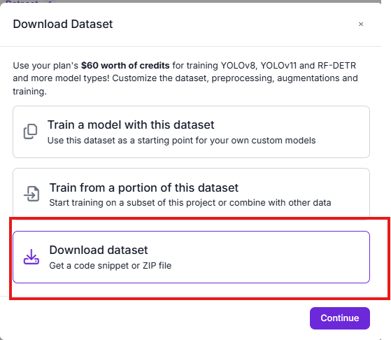

3. 格式選 **YOLOv5 PyTorch**，並選擇「Download zip to computer」（下載 zip 到電腦），下載後會得到一個 zip 檔。

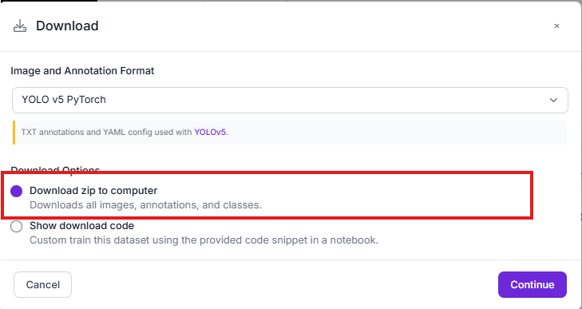

4. 讓 Colab 取得這個 zip，二選一：

   - **直接上傳**（最簡單）：notebook 儲存格 7 已經附上手動上傳的程式（以 `#` 註解起來）。把 `!wget ...` 那一行加上 `#` 註解，並取消下面三行的註解，執行時會跳出視窗，選擇剛下載的 zip 即可。每次開新的 Colab 都要重傳一次。

   - **放到自己的 GitHub Releases**：在自己的 repo 新增 Release 並上傳 zip，再把 `DATASET_URL` 換成新的下載網址（格式：`https://github.com/帳號/repo/releases/download/標籤/檔名.zip`）。

> Roboflow 的按鈕名稱與位置可能隨版本調整，以實際畫面為準。重點是匯出格式要選 **YOLOv5 PyTorch**，zip 裡要有 `data.yaml`、`train/`、`valid/`。

## 二、資料集

- **格式**：YOLO 格式，從 Roboflow 匯出（YOLOv5 PyTorch），內容有 `data.yaml`、`train/`、`valid/`、`test/`。  
- **類別**：3 類，順序為 `mask_weared_incorrect`、`with_mask`、`without_mask`（取自資料集的 `data.yaml`）。  
- **訓練集**：1,824 張圖片（與訓練時每輪 114 個批次 × 每批 16 張相符）。  
- **驗證集**：239 張圖片、1,311 個標註框。  
- **類別分布不均**：驗證集中 `with_mask` 有 991 個，`without_mask` 277 個，`mask_weared_incorrect` 只有 43 個。  
- **來源**：Roboflow Universe 的 Face Mask Detection（`sparrowdhanashree`，version 1）。圖片檔名以 `maksssksksss` 開頭，應與 Kaggle 的 Face Mask Detection 資料集同源。

資料集的下載與上傳方式見最前面的[快速開始](#快速開始資料集怎麼下載)。

## 三、操作步驟

README 內附每個步驟的完整程式碼：可以直接開啟 notebook 由上往下執行，也可以照著下面的說明，在 Colab 逐一**新增「程式碼儲存格」**並貼上程式碼。每段程式後面的「作用」說明它在做什麼。

開啟方式：上傳到 GitHub 後點最上方的 **Open In Colab** 按鈕，或在 Colab 選「檔案」→「上傳筆記本」。先把硬體切到 GPU（「執行階段」→「變更執行階段類型」→ T4 GPU）。括號內的「儲存格」編號是 notebook 由上往下的順序。

### Step 1：確認 GPU（儲存格 1）

新增一個「程式碼儲存格」，輸入：

```py
!nvidia-smi
```

作用：列出 Colab 分配到的顯示卡。實際輸出為 `Tesla T4`，顯存 0 / 15360 MiB，表示 GPU 可用且尚未被占用。

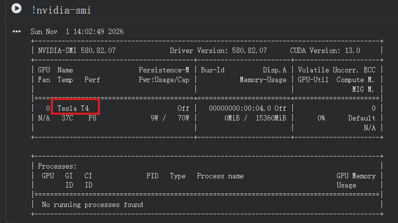

### Step 2：掛載 Google Drive 並設定路徑（儲存格 2、3）

新增一個「程式碼儲存格」，輸入：

```py
from google.colab import drive
drive.mount("/content/drive")
```

執行成功後會顯示 `Mounted at /content/drive`：

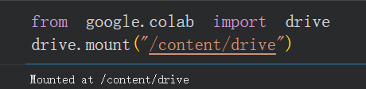

作用：讓 Colab 連接你的 Google 雲端硬碟，並對應到 `/content/drive` 目錄。執行時會跳出授權視窗，按「允許」。

再新增一個「程式碼儲存格」，輸入：

```py
DATASET_URL = "https://github.com/11325017-ship-it/yolov5-mask-detection-colab/releases/download/v1/Face.Mask.Detection.v1i.yolov5pytorch.zip"
SAVE_DIR = "/content/drive/MyDrive/yolov5_mask/runs"
```

實際畫面如下：

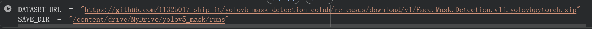

作用：設定兩個路徑，後面的程式都會用到。

- `DATASET_URL`：資料集 zip 的下載網址（GitHub Releases）。  
- `SAVE_DIR`：訓練結果存放位置。結果直接存在雲端硬碟，Colab 關閉後也不會消失。

### Step 3：下載 YOLOv5 並安裝套件（儲存格 4、5）

新增一個「程式碼儲存格」，輸入：

```py
!git clone --depth 1 https://github.com/ultralytics/yolov5
```

作用：從 GitHub 下載 YOLOv5 原始碼，`--depth 1` 表示只抓最新版本，速度較快。

再新增一個「程式碼儲存格」，輸入：

```py
%cd yolov5
%pip install -q -r requirements.txt
```

作用：進入 `yolov5` 資料夾，並安裝 YOLOv5 需要的套件。`%cd` 是相對路徑，**不要重複執行**，否則路徑會變成 `/content/yolov5/yolov5`。

### Step 4：下載並解壓縮資料集（儲存格 6～9）

新增一個「程式碼儲存格」，輸入：

```py
from pathlib import Path
import yaml, zipfile
```

作用：匯入後面會用到的套件。

再新增一個「程式碼儲存格」，輸入：

```py
!wget -q --show-progress -O /content/mask_dataset.zip {DATASET_URL}

# 使用手動上傳
# from google.colab import files
# uploaded = files.upload()
# !cp "{next(iter(uploaded))}" /content/mask_dataset.zip
```

作用：依 `DATASET_URL` 把資料集 zip 下載到 `/content/mask_dataset.zip`。`{DATASET_URL}` 會被換成上一步設定的網址。實際輸出顯示下載了 52.21 MB（約 55 MB），耗時不到 1 秒。

下面以 `#` 註解的三行是**備用方案**：如果不想用網址下載（例如要換成自己的資料集），把 `!wget` 那行加上 `#`，再取消這三行的註解，就會跳出視窗讓你手動上傳 zip。

再新增一個「程式碼儲存格」，輸入：

```py
with zipfile.ZipFile("/content/mask_dataset.zip") as z:
    z.extractall("/content/dataset")
```

作用：把 zip 解壓縮到 `/content/dataset`。

再新增一個「程式碼儲存格」，輸入：

```py
src_yaml = next(Path("/content/dataset").rglob("data.yaml"))
root = src_yaml.parent
names = yaml.safe_load(src_yaml.read_text())["names"]
```

作用：找出資料集內的 `data.yaml`，記下資料集資料夾的位置（`root`），並讀出類別名稱與順序（`names`）。

### Step 5：產生訓練設定檔（儲存格 10、11）

YOLOv5 靠設定檔知道資料集在哪、有哪些類別。新增一個「程式碼儲存格」，輸入：

```py
cfg = {"path": str(root),
      "train": "train/images",
      "val": "valid/images",
      "names": names}
Path("data/mask.yaml").write_text(yaml.dump(cfg, allow_unicode=True))
```

作用：把資料集位置、訓練集與驗證集的資料夾、類別名稱寫成 `data/mask.yaml`，下一步訓練時會用到。

再新增一個「程式碼儲存格」，輸入：

```py
print(cfg)
```

作用：印出設定內容確認。實際輸出：

```py
{'path': '/content/dataset', 'train': 'train/images', 'val': 'valid/images',
 'names': ['mask_weared_incorrect', 'with_mask', 'without_mask']}
```

### Step 6：訓練（儲存格 12）

新增一個「程式碼儲存格」，輸入：

```py
!python train.py --img 640 --batch-size 16 --epochs 50 --data data/mask.yaml \
    --weights yolov5s.pt --project {SAVE_DIR} --name mask --exist-ok
```

作用：呼叫 YOLOv5 的 `train.py`，以 `yolov5s.pt` 為起點，用口罩資料集微調模型（遷移學習）。各參數的意義如下：

| 參數 | 意義 |
| :---- | :---- |
| `--img` | 圖片縮放後的邊長（像素） |
| `--batch-size` | 每次更新參數用幾張圖；出現 `CUDA out of memory` 就改小 |
| `--epochs` | 完整看過資料集幾輪 |
| `--data` | Step 5 產生的設定檔 |
| `--weights` | 預訓練權重。從這個模型微調，比從零訓練快得多；其他可用的模型見下方「其他 YOLOv5 模型」 |
| `--project`、`--name` | 結果存放的位置與資料夾名稱 |
| `--exist-ok` | 同名資料夾已存在時直接沿用 |

#### 其他 YOLOv5 模型

YOLOv5 依「深度與寬度」分成 n、s、m、l、x 五種大小，越大越準，但也越慢、越吃顯存。要更換時，只要把 `--weights` 改成對應的檔名，權重會自動下載，其他參數不用動。

**標準模型（輸入尺寸 640）**，適合一般用途，本專案使用的是 `yolov5s`：

| 模型 | `--weights` | mAP 50-95 | mAP 50 | CPU 速度 (ms) | V100 速度 (ms) | 參數量 (M) | FLOPs (B) | 適合情境 |
| :---- | :---- | :---- | :---- | :---- | :---- | :---- | :---- | :---- |
| YOLOv5n | `yolov5n.pt` | 28.0 | 45.7 | 45 | 6.3 | 1.9 | 4.5 | 手機、嵌入式裝置，追求速度 |
| **YOLOv5s** | `yolov5s.pt` | 37.4 | 56.8 | 98 | 6.4 | 7.2 | 16.5 | **入門首選，本專案使用** |
| YOLOv5m | `yolov5m.pt` | 45.4 | 64.1 | 224 | 8.2 | 21.2 | 49.0 | 精度與速度折衷 |
| YOLOv5l | `yolov5l.pt` | 49.0 | 67.3 | 430 | 10.1 | 46.5 | 109.1 | 追求精度 |
| YOLOv5x | `yolov5x.pt` | 50.7 | 68.9 | 766 | 12.1 | 86.7 | 205.7 | 最高精度，需要較大顯存 |

> 以上數據引用自 YOLOv5 官方 README，是在 COCO 資料集（80 類）上測得的，**不代表**在本專案口罩資料集上的表現。mAP 越高越準；速度與參數量越小越快、越省資源。

換模型時要注意：

- **標準模型**：訓練與偵測的 `--img` 維持 `640`。  
- **P6 模型**：`--img` 要改成 `1280`，而且訓練與偵測要用同一個值。圖片變大，顯存需求大增，在 Colab 的 T4 上通常要把 `--batch-size` 調小（例如 4 或 8），訓練時間也會變長。  
- **較大的模型**（`m`、`l`、`x`）：同樣可能需要調小 `--batch-size`，否則會出現 `CUDA out of memory`。  
- **比較不同模型**：用不同的 `--name`（例如 `mask_m`、`mask_n`），結果才不會互相覆蓋。  
- **取捨**：不是越大越好。資料集只有一千多張圖時，較大的模型不一定有明顯的提升，卻要花更多時間，建議先用 `yolov5s` 當基準，再嘗試 `yolov5m` 或 `yolov5n` 比較。

換成 `yolov5m` 的訓練指令範例：

```sh
python train.py --img 640 --batch-size 16 --epochs 50 --data data/mask.yaml \
    --weights yolov5m.pt --project <SAVE_DIR> --name mask_m --exist-ok
```

實際執行：50 輪共花約 **0.53 小時（約 32 分鐘）**，每輪約 38 秒。訓練會自動下載 `yolov5s.pt`，並把輸出層改成 3 類（`nc=3`）。

### Step 7：查看訓練結果（儲存格 13、14）

新增一個「程式碼儲存格」，輸入：

```py
from IPython.display import Image, display
```

作用：匯入在 notebook 裡顯示圖片的工具。

再新增一個「程式碼儲存格」，輸入：

```py
display(Image(f"{SAVE_DIR}/mask/results.png"))
display(Image(f"{SAVE_DIR}/mask/confusion_matrix.png"))
```

作用：顯示訓練曲線（`results.png`）與混淆矩陣（`confusion_matrix.png`），結果分析見[第六節](#六實驗結果)。最重要的檔案是 `weights/best.pt`，它是驗證集表現最好的權重，約 14.5 MB，下一步偵測就用它。

### Step 8：偵測（儲存格 15、16、17）

新增一個「程式碼儲存格」，輸入：

```py
!python detect.py --weights {SAVE_DIR}/mask/weights/best.pt \
    --source {root}/valid/images --img 640 --conf-thres 0.4 --name mask_detect --exist-ok
```

作用：呼叫 YOLOv5 的 `detect.py`，用訓練好的 `best.pt` 偵測驗證集的圖片，結果存在 `runs/detect/mask_detect/`。

| 參數 | 意義 |
| :---- | :---- |
| `--weights` | 訓練好的模型 |
| `--source` | 要偵測的圖片或資料夾；想測自己的照片，改成你的資料夾 |
| `--conf-thres` | 信心度門檻，低於這個值的框會被丟掉。框太多就調高，漏抓就調低 |

再新增一個「程式碼儲存格」，輸入：

```py
import matplotlib.pyplot as plt
import matplotlib.image as mpimg
import glob
```

作用：匯入畫圖與讀圖的套件。

再新增一個「程式碼儲存格」，輸入：

```py
img_paths = sorted(glob.glob("runs/detect/mask_detect/*.jpg"))[:6]


fig, axes = plt.subplots(2, 3, figsize=(18, 12))
axes = axes.ravel()

for i, path in enumerate(img_paths):
    img = mpimg.imread(path)
    axes[i].imshow(img)
    axes[i].axis("off")
    axes[i].set_title(path.split("/")[-1], fontsize=10)

plt.tight_layout()
plt.show()
```

作用：把偵測結果的前 6 張圖排成 2×3 的畫面顯示出來。

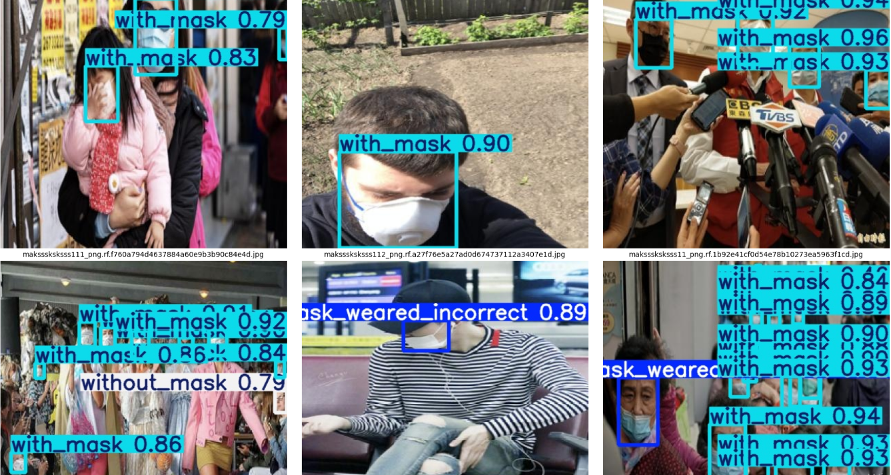

### Step 9：偵測自己的圖片（儲存格 18）

訓練好之後，可以上傳自己的照片來測試模型。新增一個「程式碼儲存格」，輸入：

```py
import os
import matplotlib.pyplot as plt
import matplotlib.image as mpimg
from google.colab import files

# 1. 讓使用者上傳圖片
uploaded = files.upload()
if uploaded:
    custom_img_name = next(iter(uploaded))
    custom_img_path = os.path.abspath(custom_img_name)

    # 2. 執行 YOLOv5 偵測
    !python detect.py --weights {SAVE_DIR}/mask/weights/best.pt \
        --source "{custom_img_path}" --img 640 --conf-thres 0.4 --name custom_detect --exist-ok

    # 3. 顯示偵測結果
    detected_img_path = f"runs/detect/custom_detect/{custom_img_name}"
    if os.path.exists(detected_img_path):
        plt.figure(figsize=(10, 10))
        img = mpimg.imread(detected_img_path)
        plt.imshow(img)
        plt.axis("off")
        plt.title("Detection Result")
        plt.show()
    else:
        print("偵測失敗，未找到結果圖片。")
```

作用：讓你上傳一張自己的圖片，用訓練好的 `best.pt` 偵測，並把結果畫出來。這一格自己匯入了需要的套件（`os`、`files`、`plt`、`mpimg`），程式分成三個部分：

1. **上傳圖片**：`files.upload()` 會跳出「選擇檔案」按鈕，選好圖片後上傳到 Colab。程式取出檔名（`custom_img_name`），並用 `os.path.abspath` 取得圖片的絕對路徑（`custom_img_path`），這樣不論目前在哪個資料夾，都能正確找到剛上傳的檔案。
2. **執行偵測**：呼叫 YOLOv5 的 `detect.py`，用 `--source` 指定剛上傳的圖片，結果存在 `runs/detect/custom_detect/`。`--source` 的路徑加上雙引號，檔名有空格也能正確處理。其餘參數與 Step 8 相同，信心度門檻 `--conf-thres` 為 0.4。
3. **顯示結果**：檢查結果圖片是否存在，存在就用 matplotlib 畫出來；找不到就印出「偵測失敗，未找到結果圖片。」

執行結果範例（左：上傳的原圖，右：偵測後的結果，模型框出口罩並標示 `with_mask`，信心度 0.95）：

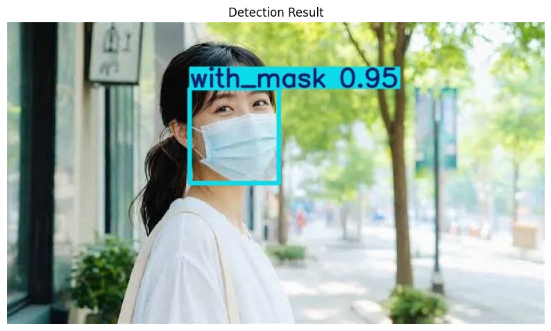

再一個例子（`with_mask`，信心度 0.94）：

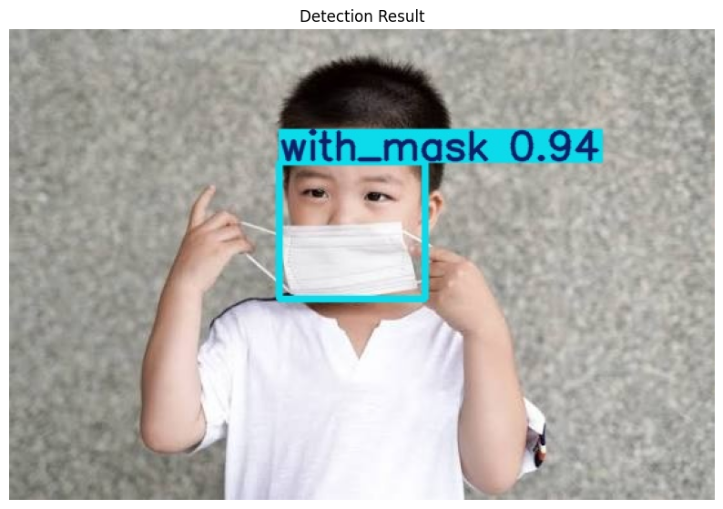

執行前的注意事項：

- **要先執行前面的步驟**：這一格用到 Step 2 的 `SAVE_DIR`、Step 3 下載的 `detect.py`，以及 Step 6 訓練出來的 `best.pt`。`detect.py` 是用相對路徑呼叫的，所以目前的資料夾必須在 `yolov5` 裡（Step 3 的 `%cd yolov5`）。如果重新開啟 Colab，至少要先重跑 Step 1～3，`best.pt` 會從雲端硬碟讀取，不必重新訓練。沒有先執行會出現 `NameError: name 'SAVE_DIR' is not defined`。
- **一次只處理一張圖**：`next(iter(uploaded))` 只取第一個上傳的檔案，一次選多張的話，只有第一張會被偵測。
- **框太多或漏抓**：調整 `--conf-thres`。框太多就調高（例如 0.5），漏抓就調低（例如 0.25）。
- **結果會被覆蓋**：因為使用 `--exist-ok`，每次執行都會沿用 `custom_detect` 資料夾，同名的圖片會被覆蓋。
- **結果不會自動保存**：上傳的照片和 `runs/detect/` 都在 Colab 的暫存空間，工作階段結束後會消失，不會上傳到雲端硬碟或 GitHub。想保留結果的話，在結果圖上按右鍵另存。

如果出現「偵測失敗，未找到結果圖片。」，通常是偵測沒有成功執行。請往上看 `detect.py` 的輸出訊息：

- 出現 `can't open file ... detect.py`：目前不在 `yolov5` 資料夾，請先執行 `%cd /content/yolov5`。
- 出現找不到 `best.pt`：確認 Step 6 的訓練結果存在雲端硬碟，且雲端硬碟已經掛載（Step 2）。
- 上傳的檔案不是圖片或格式不支援：請改用 `.jpg` 或 `.png`。

## 四、實驗結果

### 整體與各類別表現

以 `best.pt` 在驗證集（239 張、1,311 個框）上評估：

| 類別 | 標註框數 | Precision | Recall | mAP@0.5 | mAP@0.5:0.95 |
| :---- | :---- | :---- | :---- | :---- | :---- |
| **全部** | 1,311 | 0.836 | 0.752 | 0.812 | 0.505 |
| `with_mask` | 991 | 0.922 | 0.904 | 0.931 | 0.621 |
| `without_mask` | 277 | 0.893 | 0.724 | 0.823 | 0.459 |
| `mask_weared_incorrect` | 43 | 0.692 | 0.628 | 0.681 | 0.436 |

| 指標 | 意義 |
| :---- | :---- |
| Precision | 模型框出來的東西，有多少是對的 |
| Recall | 實際存在的物件，有多少被找出來 |
| mAP@0.5 | 框的重疊度（IoU）達 0.5 時的平均精確度 |
| mAP@0.5:0.95 | IoU 門檻從 0.5 到 0.95 的平均，標準更嚴格 |

### 訓練曲線


- 訓練的三種損失（`box_loss`、`obj_loss`、`cls_loss`）從第 0 輪到第 50 輪持續下降，表示模型有在學習。  
- 驗證集的 `mAP@0.5` 在前 20 輪快速上升到約 0.75，約在第 35 輪達到高點（約 0.81），之後略為下滑，到第 50 輪約 0.77。  
- Precision 在前 20 輪波動很大（約 0.54～0.93），之後比較穩定；Recall 在第 20 輪後大致持平在 0.7 附近。  
- 驗證集的 `obj_loss` 在第 12 輪前後最低，之後緩慢回升，而訓練損失仍在下降，可能是過擬合的跡象，表示第 35 輪之後再訓練的收穫有限。  
- 這也是 YOLOv5 會另外存 `best.pt` 的原因：它保存的是表現最好的那一輪，最後評估（mAP@0.5 \= 0.812）高於第 50 輪當下的 0.77。

### 混淆矩陣


此圖按「實際類別」（橫軸）為 100% 來計算：

| 實際類別 | 判對 | 主要錯誤 |
| :---- | :---- | :---- |
| `with_mask` | 91% | 約 8% 沒被偵測到 |
| `without_mask` | 76% | 約 17% 沒被偵測到，約 6% 判成 `mask_weared_incorrect` |
| `mask_weared_incorrect` | 60% | 約 21% 被判成 `with_mask`，約 9% 判成 `without_mask`，約 9% 沒被偵測到 |

### 結果分析

1. **`with_mask` 表現最好**（mAP@0.5 為 0.931）：它在資料集中占絕大多數（991 / 1,311），模型見過最多樣本。  
2. **`mask_weared_incorrect` 最弱**（Precision 0.692、Recall 0.628、mAP@0.5 僅 0.681）：驗證集只有 43 個樣本，訓練集中的樣本也可能不多；而且它的外觀與 `with_mask` 很接近，所以約五分之一被誤判成 `with_mask`。這是類別不平衡造成的典型問題。  
3. **`without_mask` 的主要問題是漏抓**：約 17% 沒被偵測出來，可能是人臉太小或被遮擋。  
4. **偵測速度**：在 T4 上，每張圖的推論約 8.2 毫秒，加上前處理 0.5 毫秒與 NMS 1.4 毫秒，共約 10 毫秒，足以做即時偵測。

### 偵測結果範例

驗證集前 6 張圖片的偵測結果：畫面中的人臉被框出並標上類別與信心度，例如 `with_mask` 的信心度多在 0.8～0.96，也能抓到一個 `mask_weared_incorrect`（0.89）。人很多的畫面中，標籤會互相重疊而不易閱讀，但框與類別仍然正確標出。（驗證集的偵測圖見上方 Step 8，自行上傳圖片的偵測結果見 Step 9。）

### 注意事項

偵測用的 `valid/images` 同時是挑選 `best.pt` 的依據，所以結果略微偏樂觀。資料集另有 `test/` 資料夾，要得到更公正的評估，可以把 `--source` 改成 `test/images`，或用 `val.py --task test` 評估。

## 五、執行時遇到的狀況

| 現象 | 說明 |
| :---- | :---- |
| 訓練開始時停住約 30 秒，並出現 `wandb: Enter your choice` 選項 | YOLOv5 詢問是否使用 Weights & Biases 記錄訓練過程。輸入 `3`（不視覺化結果）再按 Enter 可以立刻跳過；不輸入的話，30 秒後會自動停用，兩種都不影響訓練 |
| 出現 `Could not find cuda drivers on your machine, GPU will not be used` | 這是 TensorFlow 的訊息，與 YOLOv5 無關。同一份輸出的下一段是 `CUDA:0 (Tesla T4...)`，表示訓練確實用了 GPU |
| 出現 `Drive already mounted` | 代表雲端硬碟已經掛載過，不是錯誤 |
| 重複執行 `%cd yolov5` 後路徑變成 `/content/yolov5/yolov5` | `%cd` 是相對路徑，重複執行會一直往下一層。若已經在 `yolov5` 資料夾內，不要再執行 |
| `wget` 下載資料集失敗（404 Not Found） | Releases 的附件被刪除，或網址、檔名與 `DATASET_URL` 不一致（檔名要完全相同，包含大小寫與句點）。可改用「方式二」自己提供資料集 |
| Step 9 顯示「偵測失敗，未找到結果圖片。」 | 偵測沒有成功執行。常見原因：目前不在 `yolov5` 資料夾、找不到 `best.pt`，或上傳的不是圖片。請見 Step 9 最後的說明 |
| `CUDA out of memory` | 把 `--batch-size` 改成 8 或 4 |
| Colab 斷線 | 訓練結果存在雲端硬碟，不會遺失，可直接用 `best.pt` 偵測 |

## 六、結論與改進方向

本專題用 Colab 的 T4 GPU，以 `yolov5s.pt` 微調 50 輪（約 32 分鐘），在驗證集上得到 **mAP@0.5 \= 0.812**、Precision \= 0.836、Recall \= 0.752。整個流程都是呼叫 YOLOv5 現成的 `train.py` 與 `detect.py`，不需要自己寫模型。

可以再改進的方向：

- **補強少數類別的資料**：`mask_weared_incorrect` 樣本太少，增加這類圖片最有幫助。  
- **換較大的模型**：例如 `yolov5m.pt`（比較表見[其他 YOLOv5 模型](#其他-yolov5-模型)），通常能提高精度，但訓練較慢、顯存需求較高。  
- **用測試集評估**：得到更公正的成績。
